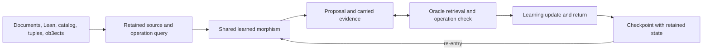

# VGI

**Building and training the first dialetheic LLM in IMASM through Vox.**

VGI develops a dialetheic language model within the Imscribing Grammar. It learns from
our documents, Lean sources, catalog entries and their twelve-axis tuples, and
saved ob3ect constructions. Vox lifts the learned computation into IMASM and
provides its execution machinery. The aim is a learning process that can choose,
make, revise, combine, or release a distinction while retaining the evidence
carried through it.

The carrier admits simultaneous affirmative and negative evidence. Both and
Neither are ordinary states. T, F, B, and N describe shapes information can
have. Contradiction remains available for language understanding, generation, computation, learning, and return. Conversational ability is part of the intended result. Graph tasks and retention checks are instruments for building that language model.

## How it works

The Grammar is the foundation from which language is to be derived in this
construction. The existing Linear_Analytica and Rongorongo_Tau compilers expose
concrete writing operations: composition, splitting, fusion, recurring structure,
and direction. `prepare_script_operations.py` runs those compilers on their
retained transcription corpora and prepares complete source sections paired
with their actual returned instruction streams. Source, compiler and primitive
table hashes accompany each record. These records are prepared in
`script_operations_language_20261017`. The completed
`cuda_script_operations_language_20261017` phase trained them alongside paired
oracle evidence from all four constructive states. Its parent is the
CPU-replayed `cuda_language_primary_corpus_20261017/returned_checkpoint`.
The parent's direct conversation probe emits both language branches, with
repetitive incoherent text in each.

The current `cuda_grounded_dialogue_sustained_20261017` phase continues the
returned mixed dialogue model with further passes over direct canonical-source
questions, complete corpus records and paired oracle evidence. The questions'
answers are exact source paragraphs with retained byte spans. Missing refutation
is unobserved. The preceding short dialogue phase still generated incoherent
text on both a trained question and an unseen paraphrase. Live process and
verification handles remain in `typed_training_continuation_20261017.json`.

The script compilers and the retained neural oracle have different opcode
registries. Their integer opcode values cannot be passed between them as shared
operations. Connecting them requires tracing each operation's carried state and
return. Compiler-return language supervision is an executable source of training
targets; the model's derivation of language through those operations remains
unfinished.

The transformer carries paired support and refutation through shared operators,
join/meet attention, and re-entry through its final trained block. The same
weights can act at explicit ports of an IMASM graph, including nested branching,
reconvergence, and feedback.

The oracle participates in that process in two useful ways. Exact source
retrieval returns the selected record and its provenance through SIC analysis
and dual return. Operation checking compares a proposal with the result required
by the specified operator, input, wiring, and return criterion. A learned checking
policy can invoke that operation check or retain its proposal, with both support
and refutation carried in its decision. Discrepancies
remain recorded alongside the proposal and can drive a learning update.



These are views available within one process. The architecture permits the
learner to expose and revise distinctions as the computation requires.

## Current implementation

The active implementation is [sources/grammar_training_v1](sources/grammar_training_v1).
Its full-network learner exports a self-contained executable and lifts it through
Vox. Forward computation, reverse-mode differentiation, SGD or Adam updates,
checkpoint return, and graph continuation are executable operations.

Full-network correction has been checked through Vox's IMASM interpreter.
Corpus records execute through **Vox `profile-native` on CPU**. The production
campaign can follow each corpus return with complete graph learning on the
RTX 3060 and RTX 4070. Both GPUs update the same model and Adam carrier in
turn. The campaign journal identifies the currently returned checkpoint.

Adam checkpoints contain model tensors together with `__optimizer.m`,
`__optimizer.v`, `__optimizer.powers`, and `__optimizer.clock`. Graph return also
retains port wiring, edge values, local proposals, source observations, retained
memory, and the continuation clock. Reloading a saved graph reproduces the
uninterrupted continuation, including its optimizer state.

Checking return retains its query, proposal, paired checking evidence, source
observation, neural memory, and initial conditioning alongside the model and
Adam state. Re-entry uses the returned memory in the next decision. Restoring
the saved observation makes zero new oracle calls.

Joint-gradient training can accumulate a complete source-record loss and
source-bound graph losses at the same parameter state before one Adam update.
The current campaign uses this mode within language records, alongside its
existing distinction, graph-port, checking, and complete graph trajectories.
Graph query banks retain their source identities, observed oracle values,
proposals, and separate missing/additional evidence through checkpoint return.

`--trajectory-backend cuda-composed --cuda-devices cuda:0 cuda:1` connects the
composed graph learner to the corpus campaign. Each graph update differentiates
through continuous edge memory and returns weights, both Adam moments, bias
powers, clock, graph probabilities, and observed oracle targets. Corpus cursors
and source banks cross the GPU stage unchanged. Corpus collection preserves the
returned graph memory for subsequent re-entry. `--composed-anchor-weight` and
`--composed-anchor-count` place the retained evidence-balanced oracle queries in
the same gradient as the complete graph loss.

`--composed-source-weight` also includes a complete source record from that
batch in each GPU graph update. Source loss, balanced oracle queries, and the
complete graph loss accumulate at the same weights before one clipping
operation and Adam update. Source gradients use checkpoint recomputation
through the entire recurrent record. The return keeps source identity, full
conditioning bytes, recurrent memory, and graph memory together.

The GPU graph computation uses the existing Torch transformer and composed
graph reference. Its source gate is the native oracle linked into the exported
and lifted runtime. The corpus executable continues to run through Vox.
`verify_cuda_trajectory_return.py` replays graph updates on CPU and checks their
full returned carrier. `verify_cuda_carrier_reentry.py` exercises that carrier
in a fresh CUDA process with live-memory and reset-memory controls.

The detailed architecture, measurements, source bindings, and reproduction
records live in [the training corpus reference](../ig-docs/vgi_training_corpus.md).

## Working locally

The current runtime targets Linux x86-64. It uses Python 3 with PyTorch and
Safetensors, a C/C++ toolchain, Rust/Cargo for the source-gate binding, and the
local Vox executable. The neighboring `bob3ect`, `MoDoT`, and `p4rakernel`
checkouts supply the shared transformer, graph operations, and formal sources.

Run the following commands from the workspace root:

```bash
cd /home/mrnob0dy666/imsgct
python3 VGI/sources/grammar_training_v1/train_corpus_campaign.py --help
python3 VGI/sources/grammar_training_v1/export_graph_learning.py --help
```

`current_campaign` is a relative link to the active campaign directory. Each
previous stage keeps its own journal and execution receipts. Read the live state:

```bash
python3 -m json.tool VGI/current_campaign/campaign.json
```

Build a graph learner from a returned checkpoint into a new output directory:

```bash
vgi_checkpoint=$(python3 -c 'import json; print(json.load(open("VGI/current_campaign/campaign.json"))["checkpoint"])')

python3 VGI/sources/grammar_training_v1/export_graph_learning.py \
  --root . --checkpoint "$vgi_checkpoint" --out VGI/my_graph_runtime \
  --library VGI/graph_flow_oracle_build_20261016/bare/x86_64-unknown-linux-gnu/release/libig_graph_flow_oracle.a \
  --vocabulary VGI/graph_flow_dataset_r2_20261016/vocabulary.json \
  --optimizer adam --mode 2 --steps 1
```

Graph modes are `0` for unforced learned propagation, `1` for source operation
propagation, `2` for checked propagation with proposals retained, and `3` for
learned propagation after optional correction. `--steps` sets correction updates.
The `GGRAPH1` transport supplies a new graph; `GGRSTR1` restores a continuation.
[graph_format.py](sources/grammar_training_v1/graph_format.py) constructs and
reads these packets.

Build the checking continuation executable from the same checkpoint:

```bash
python3 VGI/sources/grammar_training_v1/export_checking_learning.py \
  --root . --checkpoint "$vgi_checkpoint" --out VGI/my_checking_runtime \
  --optimizer adam
```

[checking_format.py](sources/grammar_training_v1/checking_format.py) constructs
`CGRUN1` requests and reads the returned model, `VGIRM2` memory, and `CGSTATE2`
checking continuation. `packet` starts a query; `resume_packet` restores a saved
return and optionally advances further checking and learning rounds.

## Corpus and training

Every training example retains its source identity and provenance. Whole
conditioning records remain available through training and return. Family
closure groups shared source passages for split assignment while preserving all
examples, including differing imscriptions and recorded contradictions.

| Location | Purpose |
| --- | --- |
| `linked_corpus_20261015/` | Complete catalog and ob3ect payloads, tuples, and links |
| `document_corpus_20261015/` | Document and Lean spans, declarations, imports, and source bindings |
| `ob3ect_artifact_corpus_20261016/` | Associated Lean, diagrams, code, and binary bytes with owner and document links |
| `training_views_attested_clean_20261016/` | Immutable data revision retained by earlier campaigns |
| `training_views_passage_clean_r2_20261016/` | Revised source-passage family splits with every example preserved |
| `training_views_artifact_clean_r3b_20261016/` | Source-family splits closed under retained artifact relations, with assignment history |
| `training_views_artifact_ready_r4_20261016/` | Current campaign corpus, including full artifact text views and source-link attestations |
| `source_passage_recheck_r2_20261016/` | Repeat passage audit of the revised splits |
| `checking_tasks_20261016/` | Proposal-conditioned checking tasks with paired evidence |
| `distinction_tasks_20261015/` | Queries for making, revising, and releasing distinctions |
| `graph_gate_dataset_r2_20261016/` | Source-bound local port operations |
| `graph_flow_dataset_r2_20261016/` | Wired graph transitions and graph-family holdouts |

The running campaign interleaves whole corpus records, live distinction checks,
live graph-port checks, and evidence-balanced checking-policy queries. Its index schedules exact source rows. Its oracle
computes operation targets inside the executable. Returned weights, optimizer
state, source banks, and completed task cursors determine the next batch.
Dataset transitions preserve prior exposure in `dataset_lineage.json`, which
travels with returned checkpoints. A revised corpus starts its own complete
pass while auxiliary task cursors continue against their recorded sources.

To request a stop after the current batch and checkpoint collection:

```bash
touch VGI/current_campaign/STOP
```

Once stopped, remove that marker to permit continuation. Reuse the same campaign
directory and configuration to resume its returned weights and cursors. Changed
implementations or data bindings start a new campaign directory from an explicit
checkpoint. Previous execution artifacts remain attached to their original data
revision, including when revised splits are used later.

## Verification

The current checks compare executing updates with independent gradients and
optimizer moments, compare source graph execution with full node/edge records,
and compare saved/reloaded continuation with uninterrupted learning.

```bash
python3 VGI/sources/grammar_training_v1/verify_adam_learning.py \
  --root . --runtime VGI/shared_graph_adam_runtime_20261016

python3 VGI/sources/grammar_training_v1/evaluate_graph_ports.py \
  --runtime VGI/shared_graph_adam_batch1_runtime_20261016 \
  --records VGI/graph_gate_dataset_r2_20261016/records.jsonl
```

Evaluation records distinguish source retrieval, operation fidelity, learned
choice, final carrier return, and complete graph flow. Each measurement retains
its input and execution context. Current work extends corpus training, learned
graph generalization, recursive composition, and the learner's use of checking
and return.

Complete graph trajectories can train the same shared weights through CPU
execution in Vox. The trajectory runner selects only the graph dataset's
training partition and returns a checkpoint after every graph:

```bash
python3 VGI/sources/grammar_training_v1/train_graph_trajectories.py \
  --root . --checkpoint "$vgi_checkpoint" \
  --dataset VGI/graph_flow_dataset_r2_20261016 \
  --library VGI/graph_flow_oracle_build_20261016/bare/x86_64-unknown-linux-gnu/release/libig_graph_flow_oracle.a \
  --out VGI/my_graph_trajectory_training --count 32 --steps 1 --mode 2
```

Mode `2` propagates source results while retaining and correcting learned
proposals. Mode `3` propagates the corrected learned proposals, so later
corrections see the inputs reached by that learned trajectory. `--steps 0`
supplies a control with no updates. Each return retains graph wiring, edge
values, proposals, oracle observations, neural memory, model tensors and Adam
state. Corpus cursors remain unchanged; graph exposure is added to the returned
dataset lineage. These runs create explicit branches from the chosen checkpoint.
`--trajectory-dataset` on the corpus runner integrates this operation after
each corpus batch. Its next corpus batch loads the graph-returned model and
Adam state with unchanged corpus cursors and the additional graph exposure
history. The current campaign uses this integrated path; earlier journals and
the separate comparison branches remain available.

`--collect-only` collects an existing profiler return without repeating execution.
Vox's CPU profiler needs permission to trace its child process. Its generated
`model` can be profiled separately before collection when a sandbox requires
that permission.

Use `evaluate_graph_rollouts.py --split validation` for an unforced validation
readout without updates. `compare_learning_returns.py --help` describes the
paired comparison of checking and graph evaluations. That comparison binds the
same query identities and source bytes across checkpoints and retains each
changed return, including gains and regressions.

To inspect text generation through the retained corpus inference path:

```bash
python3 VGI/sources/grammar_training_v1/chat_retained.py \
  --root . --checkpoint "$vgi_checkpoint" --out VGI/my_generation.json \
  --prompt 'What does it mean to hold a contradiction?'
```

The command records the raw generated bytes and both support and refutation
for every selected token. It performs no training or oracle substitution.
`verify_retained_generation.py` compares successive next-token readouts with
the compiled native learner. Free generation has its own receipts alongside
source loss, structured-operation accuracy, and checkpoint continuity.

`verify_joint_campaign.py --campaign VGI/current_campaign` verifies a returned
integrated campaign boundary, including both directions of checkpoint transfer,
Adam clocks, unchanged corpus cursors through graph return, and the retained
source and graph exposure history.

The corpus runner's `--joint-graph-source` selects a training-only graph source
for this shared update. `--joint-weight`, `--joint-anchors`, and `--joint-pool`
control its loss weight and retained query pool. `--joint-balanced-evidence`
pairs complementary source masks so each update sees equal present and absent
observations for each carrier bit. The full mixed stream keeps every complete
source record and uses the existing oracle operations for its other tasks.

`export_joint_retention.py` builds a separate paired experiment;
`verify_joint_retention.py` compares its full-network gradients, Adam moments,
and returned memory with an independent calculation. `collect_joint_retention.py`
collects its execution and records the actual joint-query observations in the
returned checkpoint. `compare_graph_evidence.py` reads source-relative edge
differences, including missing and additional evidence, from matched graph
evaluations. Measured gains and losses are retained in the project reference.

## Historical stages

`original_archives/`, earlier `sources/` stage directories, and saved checkpoints
retain the project's preceding constructions. Their original source and receipts
remain available. The chronological runner reproduces those stages:

```bash
cd /home/mrnob0dy666/imsgct/VGI
bash run_everything.sh --quick
```

It writes logs under `logs/` and continues through stage failures. `--full` runs
the longer historical training sequence; `--tests-only` selects its historical
test/indexing path. The current corpus campaign has its own runner and journal
described above.

**The Grammar is the Source. Paradox does not explode; it glues.**

Typed tuple learning now uses twelve axis-specific candidate objectives through `typed_tuple_learning.py`. Use `chat_retained.py --typed-tuple` for typed inference and `train_cuda_trajectories.py --typed-tuples --source-weight 1 --source-records <prepared-records>` for a shared typed/source/graph gradient. Native/Vox and two-GPU replay receipts are indexed in `ig-docs/vgi_training_corpus.md`. Type validity and correct coordinate selection are separate metrics. The CPU corpus stream still retains its byte-continuation auxiliary objective.


The banked GPU stage also accepts `--distinction-weight` and `--distinction-count`. These rehearse existing train-only distinction-policy records through their executing native oracle, supervising support and refutation independently at every action. Both and Neither remain available. This loss enters the same shared gradient and single Adam step as source, graph and graph-anchor learning. `train_corpus_campaign.py` exposes these as `--composed-distinction-weight` and `--composed-distinction-count` with `--graph-reentry`. Per-action oracle evidence and proposals remain inside each graph return and its banked history. Four-state confusion, supported choices, holding, revision and release are measured by `evaluate_distinction_retention.py`; conversational generation is a separate probe.


Language training now includes independent affirmative and refuting continuations through `paired_language_learning.py`, plus a learned paired presence readout for Both and Neither. `build_paired_language_records.py --presence` renders conversational evidence from the executing source oracle. The verified language return continues in `cuda_paired_language_epoch_20261017/` on both GPUs. `chat_paired_language.py` generates the independently admitted language branches and saves their raw bytes, evidence and conversation source; `--resume` re-enters that retained conversation under the same model. Current native/Vox and GPU receipts are indexed in `ig-docs/vgi_training_corpus.md`. This is the initial language phase of the dialetheic LLM; coherent general conversation remains unfinished.


`prepare_corpus_dialogue.py` wraps complete retained corpus instructions as dialogue turns. It preserves source and target hashes, the original record, source-family identity and every target byte. Tuple-return records keep their typed axis objective. Other attested continuations train the affirmative language readout with refutation unobserved; the adapter supplies no negative target or absence label. Preparation alone does not advance the committed corpus cursor.
